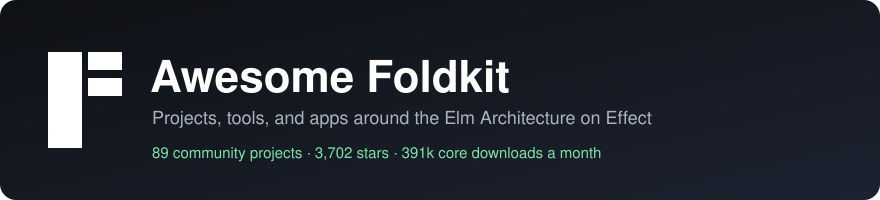

# Awesome Foldkit 

Libraries, tools, apps, and docs for [Foldkit](https://foldkit.dev), the TypeScript frontend framework built on [Effect](https://effect.website) with the Elm Architecture: one Model, a Message union, a pure update, and Commands for side effects.

  

Star and download badges load live. Every day a GitHub Action re-sorts the ecosystem by stars and flags archived or inactive projects. Every week it searches GitHub and npm for new projects.

> A Foldkit community project by [Foldhub](https://github.com/foldhub). To add a project, edit [`data/projects.toml`](data/projects.toml) and open a pull request. See [CONTRIBUTING.md](CONTRIBUTING.md).

## Contents

- [Start here](#start-here)
- [Compare and migrate](#compare-and-migrate)
- [Core packages](#core-packages)
- [Examples by the Foldkit team](#examples-by-the-foldkit-team)
- [Ecosystem](#ecosystem)
  - [Full stack and deployment](#full-stack-and-deployment)
  - [UI kits and styling](#ui-kits-and-styling)
  - [AI and agents](#ai-and-agents)
  - [Interop and tooling](#interop-and-tooling)
- [Apps built with Foldkit](#apps-built-with-foldkit)
- [Community](#community)
- [How this list stays current](#how-this-list-stays-current)

##  Start here

Foldkit docs and resources.

-  [foldkit.dev](https://foldkit.dev) - Docs, guides, and the API reference.
-  [Get started](https://foldkit.dev/get-started) - Create a project from a starter, read the generated structure, or add Foldkit to an existing app.
-  [Why Foldkit](https://foldkit.dev/introduction/why-foldkit) - Why Foldkit exists and the principles behind its design.
-  [Architecture](https://foldkit.dev/core/architecture) - How Model, Messages, update, view, Commands, Subscriptions, and the Runtime fit together.
-  [Counter example](https://foldkit.dev/core/counter-example) - A minimal app traced through its Model, Message Schema, update, view, and init.
-  [Playground](https://foldkit.dev/playground) - Edit and run a Foldkit app in the browser.
-  [Testing](https://foldkit.dev/testing) - Story tests drive update directly; Scene tests drive the rendered view.
-  [Server rendering](https://foldkit.dev/core/server-rendering) - Render the same app to HTML at request time or build time, then hydrate it.
-  [AI overview](https://foldkit.dev/ai/overview) - Agent skills, the DevTools MCP server, and llms.txt for coding agents.
-  [llms.txt](https://foldkit.dev/llms.txt) - Index of every docs page for language models; append .md to any page URL for Markdown.
-  [Roadmap](https://foldkit.dev/introduction/roadmap) - Where Foldkit is today and the work left before 1.0.
-  [Performance](https://foldkit.dev/faq/performance) - Rendering cost model and TodoMVC benchmark results.
-  [Foldkit on Cloudflare Workers](https://developers.cloudflare.com/workers/framework-guides/web-apps/foldkit/) - Cloudflare's guide to deploying a Foldkit app on Workers.

##  Compare and migrate

Side-by-side builds and migration guides.

-  [Foldkit vs React](https://foldkit.dev/react/foldkit-vs-react-side-by-side) - The same pixel art editor built in both, compared on state, side effects, testing, and performance.
-  [Foldkit vs React + Effect Atom](https://foldkit.dev/react/foldkit-vs-react-effect-atom) - One Model and a Message union compared with state spread across atoms, for teams that already use Effect.
-  [Foldkit vs Elm](https://foldkit.dev/elm/foldkit-vs-elm-side-by-side) - The same app in both: ports vs Commands, decoders vs Schema.
-  [Coming from React](https://foldkit.dev/react/coming-from-react) - How one Model and Messages replace component state and useEffect.
-  [Coming from TanStack Query](https://foldkit.dev/react/coming-from-tanstack-query) - How AsyncData in the Model replaces useQuery.
-  [rhino-labs/web-framework-comparison](https://github.com/rhino-labs/web-framework-comparison) - The same content site built in Foldkit and four React frameworks, with a Playwright harness for production-build request counts, JavaScript weight, and LCP. 
-  [MapleTechLabs/maple-ui-parity](https://github.com/MapleTechLabs/maple-ui-parity) - Pixel and behavior parity harness used to migrate Maple from React to Foldkit, with Playwright screenshot comparisons and call-log diffs. 

##  Core packages

Published from the [foldkit/foldkit](https://github.com/foldkit/foldkit) monorepo. All versions move together.

-  [foldkit](https://www.npmjs.com/package/foldkit) - The framework: Runtime, html builders, routing, Commands, Subscriptions, Mounts, Story and Scene tests. [Docs](https://foldkit.dev/core/architecture).  
-  [@foldkit/ui](https://www.npmjs.com/package/@foldkit/ui) - Headless, accessible components (Dialog, Menu, Listbox, Combobox, Popover, Calendar, and more) built as Submodels. [Docs](https://foldkit.dev/ui/overview). 
-  [create-foldkit-app](https://www.npmjs.com/package/create-foldkit-app) - Scaffold a new Foldkit app. [Docs](https://foldkit.dev/get-started). 
-  [@foldkit/vite-plugin](https://www.npmjs.com/package/@foldkit/vite-plugin) - Vite plugin with state-preserving live reload, view identity, and server rendering in dev. [Docs](https://foldkit.dev/core/preserve-scroll). 
-  [@foldkit/devtools](https://www.npmjs.com/package/@foldkit/devtools) - In-browser DevTools overlay with Message history, Model diffs, and time travel. [Docs](https://foldkit.dev/core/devtools). 
-  [@foldkit/devtools-mcp](https://www.npmjs.com/package/@foldkit/devtools-mcp) - MCP server that lets coding agents read the Model, dispatch Messages, and time travel in a running app. [Docs](https://foldkit.dev/ai/mcp). 
-  [@foldkit/oxlint-plugin](https://www.npmjs.com/package/@foldkit/oxlint-plugin) - Oxlint rules for Foldkit conventions. [Docs](https://foldkit.dev/tooling/oxlint-plugin). 
-  [@foldkit/markdown](https://www.npmjs.com/package/@foldkit/markdown) - Write Markdown files and get Foldkit views with live islands. 

##  Examples by the Foldkit team

Apps and examples from the Foldkit maintainers.

-  [foldkit/coverchart](https://github.com/foldkit/coverchart) - App for writing chord charts with lyrics. 
-  [foldkit/patch-match](https://github.com/foldkit/patch-match) - Game: match the patch. 
-  [Example apps](https://foldkit.dev/example-apps) - From a counter to multiplayer games, each with source and a playground.
-  [Typing Terminal](https://typingterminal.com) - Multiplayer typing game; its source is in packages/typing-game of the Foldkit repo.

##  Ecosystem

Community libraries and tools. Each subsection is sorted by GitHub stars.

### Full stack and deployment

Backends, hosting, and starters around a Foldkit frontend.

-  [Alchemy examples](https://github.com/alchemy-run/alchemy/tree/main/examples) - Infrastructure as Effect code, with Foldkit examples for Cloudflare (static and SSR), AWS, Fly, Hetzner, Railway, Neon, and Prisma. 
-  [Confect (@confect/foldkit)](https://github.com/rjdellecese/confect) - Convex with Effect, with client bindings for Foldkit apps.  
-  [joelhooks/rat-stack](https://github.com/joelhooks/rat-stack) - TypeScript scaffold for agent-built apps with Effect 4, XState, Alchemy, and a Foldkit documentation reader. 
-  [just-be-dev/cafe-stack](https://github.com/just-be-dev/cafe-stack) - Full-stack Cloudflare starter template combining Foldkit, Effect, Bun, mise, and Alchemy. 
-  [NolanGC/foldkit-alchemy-starter](https://github.com/NolanGC/foldkit-alchemy-starter) - Starter for full-stack apps with Foldkit and Alchemy. 
-  [lloydrichards/stack-effect](https://github.com/lloydrichards/stack-effect) - Scaffolds Effect apps from composable modules, with a Foldkit client module. 
-  [elianiva/nook](https://github.com/elianiva/nook) - Spaced-repetition application with a Foldkit frontend for decks and reviews using FSRS scheduling. 
-  [mwarger/foldkit-convex-clerk-lab](https://github.com/mwarger/foldkit-convex-clerk-lab) - Architecture lab for Foldkit with Convex, Clerk, and Confect. 
-  [elianiva/cafe-template](https://github.com/elianiva/cafe-template) - Full-stack starter on Cloudflare, Alchemy, Foldkit, and Effect, with the website and API as separate Workers. 
-  [yatainc/cafe-stack](https://github.com/yatainc/cafe-stack) - Cloudflare, Alchemy, Foldkit, and Effect starter using Nix and Vite+. 
-  [create-foldkit-alchemy-app](https://www.npmjs.com/package/create-foldkit-alchemy-app) - Scaffolds a Foldkit, Alchemy, and Cloudflare full-stack app. 
-  [Potti1234/zero-foldkit](https://github.com/Potti1234/zero-foldkit) - Rocicorp Zero sync engine bindings for Foldkit. 
-  [guidefari/efa-template](https://github.com/guidefari/efa-template) - Effect and Alchemy starter with a Foldkit frontend, Better Auth account flows, StyleX, and Cloudflare D1. 
-  [willtraweek/vibe-starter](https://github.com/willtraweek/vibe-starter) - Starter template generator with a preset stack for Foldkit, Effect v4, Vite, and Playwright. 

### UI kits and styling

Components, styling systems, and icons. Several kits follow the shadcn/ui copy-in model, so check this list before you start a new one.

-  [elianiva/foldcn](https://github.com/elianiva/foldcn) - shadcn/ui components ported to Foldkit. 
-  [Manzanita-Research/pleat](https://github.com/Manzanita-Research/pleat) - Algebraic, typed atomic CSS styling system for Foldkit and Effect. [Docs](https://pleat.manzanita.dev). 
-  [bjacobso/foldworks](https://github.com/bjacobso/foldworks) - Themeable components, a data grid, and a form builder for Foldkit, styled with StyleX.  
-  [boozedog/foldstylex](https://github.com/boozedog/foldstylex) - shadcn-inspired styling for Foldkit with StyleX. 
-  [Potti1234/creaseui](https://creaseui.com) - Component library porting the shadcn/ui design language to Foldkit and Foldkit UI. 
-  [boozedog/foldstryx](https://github.com/boozedog/foldstryx) - Astryx-inspired styling for Foldkit with StyleX.  
-  [foldkit-viz](https://github.com/opsydyn/fold-kit-experiments) - Chart and visualization primitives for Foldkit without D3.  
-  [classy-foldkit](https://github.com/djgrant/classy) - Typed component factories with CSS classes for Foldkit views.  
-  [oleksandr-antonenko/foldkit-extras](https://github.com/oleksandr-antonenko/foldkit-extras) - Command palette, time-grid scheduler, and grouped side navigation components.  
-  [birbprophet/shadcn-ui-foldkit](https://github.com/birbprophet/shadcn-ui-foldkit) - shadcn/ui port for Foldkit. 
-  [MentalGear/foldkit-shadcn](https://github.com/MentalGear/foldkit-shadcn) - shadcn/ui port for Foldkit. 
-  [skoshx/foldkit-icons](https://github.com/skoshx/foldkit-icons) - Icon views for Foldkit. 
-  [planetaryescape/foldkit-mde](https://github.com/planetaryescape/foldkit-mde) - Markdown editor component and playground with visual and raw editing modes and IndexedDB persistence. 
-  [birbprophet/untitled-ui-foldkit](https://github.com/birbprophet/untitled-ui-foldkit) - Untitled UI port for Foldkit. 
-  [birbprophet/boneyard-foldkit](https://github.com/birbprophet/boneyard-foldkit) - Responsive skeleton loaders for Foldkit views. 
-  [Potti1234/foldkit-lucide-icons](https://github.com/Potti1234/foldkit-lucide-icons) - Lucide icons as Foldkit views.  
-  [@plana-solutions/agent-interface](https://www.npmjs.com/package/@plana-solutions/agent-interface) - OpenUI chat interface implemented as a native Foldkit program, with AG-UI event handling and generative UI views. 

### AI and agents

Tools that give coding agents or in-app agents access to a Foldkit app.

-  [aurelienbobenrieth/agentlint](https://github.com/aurelienbobenrieth/agentlint) - Flags risky judgment calls in changes from coding agents, with a Foldkit review UI. 
-  [dearlordylord/hapsland](https://github.com/dearlordylord/hapsland) - Real-time semantic review for coding agents, with a Foldkit flow view. 
-  [acoyfellow/coil](https://github.com/acoyfellow/coil) - Runs one agent per thread in a Cloudflare Container and Durable Object, with a Foldkit client. 
-  [joelhooks/rat-king](https://github.com/joelhooks/rat-king) - Encrypted agent network with a public connection page rendered by Foldkit. 
-  [doeixd/foldkit-plus](https://github.com/doeixd/foldkit-plus) - Exposes a Foldkit app's Model and Messages to agents through WebMCP, MCP, and A2A, plus forms, CRUD, sync, and server rendering packages.  
-  [acoyfellow/tardigrade](https://github.com/acoyfellow/tardigrade) - Reference app for an agent that comes back after you stop it, built on Durable Objects with a Foldkit UI. 
-  [dallenpyrah/creasekit](https://github.com/dallenpyrah/creasekit) - Inspect elements, leave notes, and share that context with coding agents through MCP.  
-  [tao-io/foldcase](https://github.com/tao-io/foldcase) - Headless test loop for Foldkit components with Schema reports and an MCP catalog for coding agents. 
-  [just-be-dev/foldmark](https://github.com/just-be-dev/foldmark) - Visual feedback widget that annotates UI elements and exports reports for coding agents. 
-  [bjacobso/threadvm](https://github.com/bjacobso/threadvm) - Git-versioned outline where people write intent and agents do the work, with a Foldkit UI. 
-  [elianiva/oru](https://github.com/elianiva/oru) - Agent control plane with a plugin-based Foldkit interface, persistent sessions, and harness bridges. 
-  [deracs/effect-webmcp](https://github.com/deracs/effect-webmcp) - Effect tools and layers for the WebMCP browser API, usable from Foldkit Commands.  
-  [tao-io/foldkit-design](https://github.com/tao-io/foldkit-design) - Claude Design template and Claude Code skill for prototyping Foldkit apps. 
-  [birbprophet/webmcpifier](https://github.com/birbprophet/webmcpifier) - Authoring studio and compiler turning web tasks into WebMCP tools for browser agents. 
-  [In-Time-Tec/rika](https://github.com/In-Time-Tec/rika) - Coding-agent CLI where every turn is a durable execution, with a Foldkit web app. 
-  [In-Time-Tec/generalist](https://github.com/In-Time-Tec/generalist) - Typed, durable agent runtime for Effect, with a docs site built with Foldkit. 
-  [just-be-dev/traces](https://github.com/just-be-dev/traces) - Collects and searches agent traces on Cloudflare, built with Effect 4, Alchemy, and Foldkit. 
-  [just-be-dev/automations](https://github.com/just-be-dev/automations) - Builds repeatable agent automations through conversation, on Cloudflare, Alchemy, Foldkit, and Effect. 
-  [elianiva/saku](https://github.com/elianiva/saku) - Web chat for pi coding agents, with one durable thread per agent. 
-  [mshubitidze/pi-cf](https://github.com/mshubitidze/pi-cf) - Personal chat agent on one Cloudflare Worker and Durable Object, with a Foldkit UI. 
-  [NickSuomi/heron](https://github.com/NickSuomi/heron) - Self-hosted code review bot for GitLab merge requests, with a Foldkit site. 
-  [qdhenry/site-discovery](https://github.com/qdhenry/site-discovery) - Captures website pages with Cloudflare Browser Run and analyzes them with Claude, with a Foldkit UI. 
-  [kimlercorey/aimy-v0](https://github.com/kimlercorey/aimy-v0) - Local agent companion with a Foldkit chat interface and a separate memory and agent runtime. 
-  [sakompella/cf-stumble](https://github.com/sakompella/cf-stumble) - Experimental Cloudflare agent harness with a Foldkit owner interface for projects and conversations. 
-  [phibkro/chatlog](https://github.com/phibkro/chatlog) - Local conversation-memory tool for coding agents with a Foldkit workbench for evidence and reviewed insights. 
-  [kamn/empty-vessel](https://github.com/kamn/empty-vessel) - Experimental coding agent whose terminal interface uses Foldkit Messages, Commands, and update returns. 
-  [r4ravi2008/remix-workflow-v3](https://github.com/r4ravi2008/remix-workflow-v3) - Automated song-remixing pipeline with a Foldkit studio for artist profiles, audio analysis, and video releases. 
-  [Nod](https://github.com/grmkris/hack-meridian-2026) - Stellar wallet with a Foldkit web interface and embedded MCP cards for agent payment allowances and passkey approvals. 

### Interop and tooling

Bridges to React, Astro, and Storybook, plus developer tools.

-  [Manzanita-Research/foldkit-native](https://github.com/Manzanita-Research/foldkit-native) - Renders Foldkit apps natively with GPUI through gpuix. 
-  [Aniket-508/foldocs](https://github.com/Aniket-508/foldocs) - Documentation site framework built on Foldkit.  
-  [millionco/openstory](https://github.com/millionco/openstory) - Storybook for coding agents, with a Foldkit integration. 
-  [Manzanita-Research/foldkit-dials](https://github.com/Manzanita-Research/foldkit-dials) - Live tuning controls for Foldkit apps that bind Effect Schemas directly to Messages. 
-  [OpenAgentsInc/three-effect](https://github.com/OpenAgentsInc/three-effect) - Three.js in Effect, with a Foldkit integration package. 
-  [filipfalcon/lightocean](https://github.com/filipfalcon/lightocean) - Engine for real-time web applications and games with Three.js on WebGPU, Effect, and a Foldkit UI. 
-  [causeeffect (foldkit-jsx)](https://github.com/crutchcorn/causeeffect) - JSX for Effect, with a JSX adapter for Foldkit's typed view builders.  
-  [foldkit-native (Expo)](https://github.com/giovannilondero/foldkit-native) - Renders Foldkit apps natively on iOS and Android via Expo and React Native Fabric. 
-  [kondaurovDev/procdeck](https://github.com/kondaurovDev/procdeck) - Runs a whole dev stack with one command, with a Foldkit browser UI for processes, ports, and logs. 
-  [@opsydyn/astro-foldkit](https://github.com/opsydyn/fold-kit-experiments) - Astro integration and renderer for Foldkit. 
-  [rodygosset/react-foldkit](https://github.com/rodygosset/react-foldkit) - React bindings that use Foldkit's Command, Message, Update, and Subscription vocabulary. 
-  [birbprophet/storybook-renderer-foldkit](https://github.com/birbprophet/storybook-renderer-foldkit) - Storybook renderer that mounts the real Foldkit runtime per story. 
-  [saiashirwad/foldkit-explore](https://github.com/saiashirwad/foldkit-explore) - State-space explorer that enumerates a Foldkit program's transitions and renders reachable states on one page. 
-  [toshiki-higa/vite-plugin-foldkit-routes](https://github.com/toshiki-higa/vite-plugin-foldkit-routes) - Vite plugin that generates file-based routing and typed layouts for Foldkit applications. 
-  [astahmer/jj-plus](https://github.com/astahmer/jj-plus) - VS Code extension for Jujutsu and Git history, with a Foldkit webview. 
-  [bjacobso/module-ls](https://github.com/bjacobso/module-ls) - Codebase explorer and CLI with a Foldkit interface for source trees, symbol information, and guided walkthroughs. 
-  [chr33s/effect-reconciler](https://github.com/chr33s/effect-reconciler) - Effect resource-lifetime library with Foldkit integration examples for state-driven resource ownership. 
-  [opsydyn/astro-azure-integration](https://github.com/opsydyn/astro-azure-integration) - Astro adapter for Azure Static Web Apps with an example that includes a Foldkit island. 

##  Apps built with Foldkit

Applications with public source you can read to learn real patterns.

-  [MapleTechLabs/maple](https://github.com/MapleTechLabs/maple) - OpenTelemetry observability platform. Its local UI uses Foldkit, Foldkit UI, and Foldkit Markdown. 
-  [MapleTechLabs/hazel](https://github.com/MapleTechLabs/hazel) - Real-time team chat, with a Foldkit web client next to the React client. 
-  [Effect-TS/slopcop](https://github.com/Effect-TS/slopcop) - Effect's GitHub triage bot, with a Foldkit UI and Foldkit agent skills. 
-  [Effect-TS/cafe](https://github.com/Effect-TS/cafe) - Minimal chat application built with Cloudflare, Alchemy, Foldkit, and Effect. 
-  [joelhooks/potion-calendar](https://github.com/joelhooks/potion-calendar) - Google Calendar clone built with Effect 4, Alchemy, and Foldkit on Cloudflare Workers. 
-  [julia-script/effect-inspect](https://github.com/julia-script/effect-inspect) - Performance inspector and flame chart for Effect 4 programs, with a Foldkit frontend.  
-  [IMax153/twitch-integrations](https://github.com/IMax153/twitch-integrations) - Twitch integrations built with Effect, with a broadcaster page as a Foldkit app. 
-  [acoyfellow/hark](https://github.com/acoyfellow/hark) - Voice-driven web assistant with durable memory and MCP tool support, built with Foldkit, Effect, and Cloudflare Workers. 
-  [chr33s/git](https://git.chr33s.dev) - Git smart-HTTP protocol server, CLI, and browser client built with Foldkit. 
-  [acoyfellow/skin](https://github.com/acoyfellow/skin) - Self-rewriting web app with an embedded agent and automatic rollback, built with Foldkit, Effect, and Cloudflare Workers. 
-  [bjacobso/triplex](https://triplex.build) - Bitemporal fact database built on Effect, featuring an interactive Foldkit dashboard. 
-  [Effect-TS/janitor](https://github.com/Effect-TS/janitor) - Effect's GitHub labeling bot, with a Foldkit web UI. 
-  [elianiva/lutra](https://lutra.elianiva.com) - Film-simulation and color-grading tool with WebGPU shaders and a Foldkit UI. 
-  [SyahrulBhudiF/Dearly](https://github.com/SyahrulBhudiF/Dearly) - Private diary for dated memories on a freeform canvas. 
-  [bjacobso/forma](https://github.com/bjacobso/forma) - Typed Lisp for building domain-specific languages, with a Foldkit workbench. 
-  [tomrford/vscope](https://github.com/tomrford/vscope) - Local daemon and Foldkit UI for an embedded debug interface. 
-  [bjacobso/schematics](https://github.com/bjacobso/schematics) - Config-as-code control plane in Effect for external APIs and SaaS resources, with Foldkit landing-page simulations. 
-  [kndwin/fullstack-effect](https://github.com/kndwin/fullstack-effect) - Team workspace and project collaboration application built with Effect and Foldkit. 
-  [mwarger/corefour](https://github.com/mwarger/corefour) - Pick four games that shaped you and share them as a poster, on Cloudflare Workers. 
-  [guidefari/here_hugo](https://github.com/guidefari/here_hugo) - GPU playground with random-dot and noise-beam scenes built with Foldkit alongside a Hugo blog. 
-  [joelhooks/howtoyoutube](https://github.com/joelhooks/howtoyoutube) - Single-page guide to making developer YouTube videos, prerendered with Foldkit to static HTML. 
-  [edmundmiller/edmundmiller.dev](https://github.com/edmundmiller/edmundmiller.dev) - Personal publication site built with Foldkit, with Markdown compilation, prerendering, search, and interactive charts. 
-  [filipfalcon/skoreova](https://github.com/filipfalcon/skoreova) - Women's soccer in Czechia: clubs, players, fixtures, and charts. 
-  [solcik/agent-grilling](https://github.com/solcik/agent-grilling) - Local inbox where agents post decisions and you answer them in one browser panel. 
-  [mpsuesser/Dojo](https://dojo.bingo) - Specialized elicitation interfaces for capturing thoughts into agent-legible forms. 
-  [planetaryescape/gbfm](https://github.com/planetaryescape/gbfm) - Public archive of curated music at goosebumps.fm. 
-  [tao-io/foldkit-gallery](https://github.com/tao-io/foldkit-gallery) - Every @foldkit/ui component on its own page, with Model assertions. 
-  [NolanGC/parcel](https://parcelmail.dev) - Email client with a Foldkit frontend, Effect HTTP API backend, and local sync. 
-  [pkallos/wan-monitor](https://github.com/pkallos/wan-monitor) - Self-hosted network monitoring dashboard tracking latency, packet loss, and speed tests. 
-  [johnschoeman/outsider-ui](https://github.com/johnschoeman/outsider-ui) - Browser game interface for Outsider, built with Foldkit and Effect. 
-  [sunwrobert/beautiful-mermaid-viewer](https://beautiful-mermaid-viewer.sunwrobert.workers.dev) - Live Mermaid diagram editor and previewer built with Foldkit. No commits since 2026-03-18. 
-  [NigelThorne/foldkit-demo](https://github.com/NigelThorne/foldkit-demo) - Shared session counter app built with Foldkit, Cloudflare Durable Objects, SQLite, and Alchemy. 
-  [mariusom/optio](https://github.com/mariusom/optio) - Time-study application built with Foldkit for recording task observations, reviewing sessions, and exporting results. 
-  [Reilley64/mtgfr](https://github.com/Reilley64/mtgfr) - Four-player Commander card-game table with a Rust rules engine and a Foldkit client. 
-  [mpsuesser/interview-me-phonecall](https://github.com/mpsuesser/interview-me-phonecall) - Telephone voice interviewer with a Foldkit website for recordings and caller preferences. 
-  [just-be-dev/entity-store](https://github.com/just-be-dev/entity-store) - Entity store on Cloudflare D1 with a Foldkit interface for schemas, versioned transformations, and linked records. 
-  [bjoerge/battery-calculator](https://github.com/bjoerge/battery-calculator) - Battery-life calculator built with Foldkit for comparing power draw, duty cycles, chemistry, and cell layouts. 
-  [ByronLi8565/bookclub](https://github.com/ByronLi8565/bookclub) - Collaborative book club application with an EPUB and PDF reader, command palette, and note-taking built with Foldkit. 
-  [uripont/msf-case-desk](https://github.com/uripont/msf-case-desk) - Case triage and decision dashboard for Médecins Sans Frontières ethics and behaviour teams, built with Foldkit and Effect. 
-  [arijit-gogoi/web-forth](https://github.com/arijit-gogoi/web-forth) - Forth VM with a Foldkit and CodeMirror REPL. 
-  [fellz/booking_widget_effect](https://github.com/fellz/booking_widget_effect) - Hotel booking widget ported from Vue 3 to Foldkit, with an audit of state-modelling holes. 
-  [dearlordylord/pathfinder-armor-puzzle-solver](https://github.com/dearlordylord/pathfinder-armor-puzzle-solver) - Pathfinder armor puzzle solver. 
-  [jordangarrison/tic-tac-toe-4-in-a-row](https://github.com/jordangarrison/tic-tac-toe-4-in-a-row) - 8x8 exact-four scoring game. 
-  [roottool/retort](https://github.com/roottool/retort) - Page that shows the infrastructure that serves it. 
-  [ricardocasares/keiso](https://keiso-theta.vercel.app) - Browser WGSL live-coding studio and VJ software built with Foldkit and WebGPU. 
-  [Hokia-Labs/stream](https://github.com/Hokia-Labs/stream) - Engineering requirements graph and agent orchestration workspace built with Foldkit. 
-  [LouisLec/music-theory-lessons](https://music-theory-lessons.vercel.app) - Interactive music theory lessons application built with Foldkit and Effect. 
-  [Matthieusz/party-planner](https://github.com/Matthieusz/party-planner) - Party planning application built with Foldkit, Effect HTTP API, Yielded Auth, and Cloudflare D1. 
-  [planetaryescape/invoicing](https://github.com/planetaryescape/invoicing) - Business invoicing application featuring a Foldkit web interface. 
-  [sulthonuladib/abogoboga](https://github.com/sulthonuladib/abogoboga) - Cryptocurrency market data service and arbitrage tracking tool with a Foldkit control plane. 
-  [Manzanita-Research/language-galaxy](https://language-galaxy.jem.computer) - Explorable family tree of functional programming languages and ideas, built with Foldkit and WebGPU. 
-  [NigelThorne/stack_manager_website](https://github.com/NigelThorne/stack_manager_website) - Product site and interactive workflow demo for Stack Manager, built with Foldkit SSR and deployed with Alchemy. 
-  [egorkarimov/mediterranean-hill-town](https://github.com/egorkarimov/mediterranean-hill-town) - Animated 3D isometric Mediterranean hill town artwork built with Bun, Effect, Foldkit SSR, and Three.js. 
-  [gjermundgaraba/clankerauth](https://github.com/gjermundgaraba/clankerauth) - Self-hosted OAuth server for private apps and MCP servers, with a Foldkit admin UI. 
-  [eknowles/coordkit](https://github.com/eknowles/coordkit) - Shows a WGS84 position in ten coordinate systems on a live map. 
-  [laroccacharly/humi](https://github.com/laroccacharly/humi) - Logs temperature and humidity from a SwitchBot meter and charts them in a Foldkit UI. 
-  [phibkro/job-application-assistant](https://github.com/phibkro/job-application-assistant) - Job-application workspace with a Foldkit frontend for browsing vacancies, managing profile facts, and tracking applications. 
-  [rxssula/github-card](https://github.com/rxssula/github-card) - Foldkit application that turns a GitHub profile into a downloadable image card. 
-  [XiNiHa/helpspeaking-downloader](https://github.com/XiNiHa/helpspeaking-downloader) - Lesson-recording library built with Foldkit, with a pattern lock and ffmpeg transcoding on Cloudflare. 
-  [nalpr/opencode-luminacad](https://github.com/nalpr/opencode-luminacad) - Parametric lamp-shade modeller built with Foldkit and Three.js, with STL export and a STEP-script workflow. 
-  [dearlordylord/piglatin](https://github.com/dearlordylord/piglatin) - Pig Latin transformation explorer and animator built with Foldkit, with executable Quint specifications and model-based tests. 
-  [elianiva/quorum](https://github.com/elianiva/quorum) - System design learning game built with Foldkit, Effect, and Alchemy on Cloudflare Workers. 
-  [thiagofelix/isavail](https://github.com/thiagofelix/isavail) - Domain availability service for Brazilian domains with a Foldkit frontend, HTTP API, and SQLite cache. 
-  [martinthommesen/std](https://github.com/martinthommesen/std) - Service platform for records, forms, and workflows with a Foldkit web client and generic data engine. 
-  [laroccacharly/ccal](https://github.com/laroccacharly/ccal) - Meeting booking application with a Foldkit booking calendar and automated Google Meet invitations. 
-  [lambdasolver2/winning-is-a-bug-effect](https://github.com/lambdasolver2/winning-is-a-bug-effect) - Port of Victor Taelin's flag-capture puzzle game, with machine-checked proofs in Effect and a Foldkit web interface. 
-  [phibkro/course-data-platform](https://github.com/phibkro/course-data-platform) - University course browser with a Foldkit frontend for comparing subjects, planning schedules, and tracking degree progress. 
-  [elianiva/photo.elianiva.com](https://github.com/elianiva/photo.elianiva.com) - Photography portfolio and catalog with a Foldkit frontend, image metadata extractor, and Cloudflare R2 storage. 
-  [vektorprogrammet/mono-web](https://github.com/vektorprogrammet/mono-web) - School volunteer platform with Foldkit dashboard modules for recruitment, interviews, scheduling, and school visits. 
-  [MichaelVessia/garage](https://github.com/MichaelVessia/garage) - Health tracking application for injections, schedules, and weight logs, built with Foldkit, Effect RPC, and Cloudflare D1. 
-  [oldgeese/ryutama-charsheet](https://github.com/oldgeese/ryutama-charsheet) - Character sheet manager for the Ryuutama tabletop RPG, built with Foldkit and Firebase. 
-  [AlexanderDev2004/hlsl-editor](https://github.com/AlexanderDev2004/hlsl-editor) - Visual node graph editor simulator for HLSL shaders, built with Foldkit. 
-  [mococa/foldkit-todo](https://github.com/mococa/foldkit-todo) - Todo application built with Foldkit, featuring Google authentication and typed routing. 
-  [ZloiY/FoldkitApp](https://github.com/ZloiY/FoldkitApp) - Dating application prototype built with Foldkit and UnoCSS. 
-  [djobbo/timeline](https://github.com/djobbo/timeline) - Multi-track timeline editor for arranging and trimming media clips, built with Foldkit. 
-  [roninlp/jibkeep-effect](https://github.com/roninlp/jibkeep-effect) - Household expense tracker and ledger built with Effect and Foldkit. 
-  [gregwebs/tiny-desk-splitter](https://github.com/gregwebs/tiny-desk-splitter) - Audio splitter and concert player for NPR Tiny Desk Concerts with a Foldkit playback interface. 
-  [michielryvers/retro](https://github.com/michielryvers/retro) - Team retrospective tool built with Foldkit and Cloudflare Durable Objects, with private notes, voting, and action items. 

##  Community

Places to ask questions and follow releases.

-  [Discord](https://discord.gg/kav8VNxqGm) - Foldkit Discord server.
-  [GitHub Discussions](https://github.com/foldkit/foldkit/discussions) - Ideas, questions, and show-and-tell.
-  [Blog](https://foldkit.dev/blog) - Release announcements and deep dives. [RSS](https://foldkit.dev/blog/rss.xml).
-  [Newsletter](https://foldkit.dev/newsletter) - Release news by email.
-  [Elm Discourse thread](https://discourse.elm-lang.org/t/foldkit-the-elm-architecture-in-typescript-powered-by-effect/10579) - Foldkit introduced to the Elm community.
-  [Marve10s/awesome-effect](https://github.com/Marve10s/awesome-effect) - Awesome list for the whole Effect ecosystem. 

## How this list stays current

- Badges come from [shields.io](https://shields.io) and show live star and download counts.
- [`build.yml`](.github/workflows/build.yml) runs every day. It reads GitHub and npm, sorts each ecosystem section by stars, flags archived projects and projects with no commits for 180 days, and redraws the banner.
- [`discover.yml`](.github/workflows/discover.yml) runs every week. It searches GitHub and npm for new Foldkit projects and lists the ones that are not here yet in an issue.

## License

[CC0 1.0](LICENSE). The Foldkit name and logo follow the [Foldkit community branding guidelines](https://github.com/foldkit/foldkit/blob/main/BRANDING.md).
